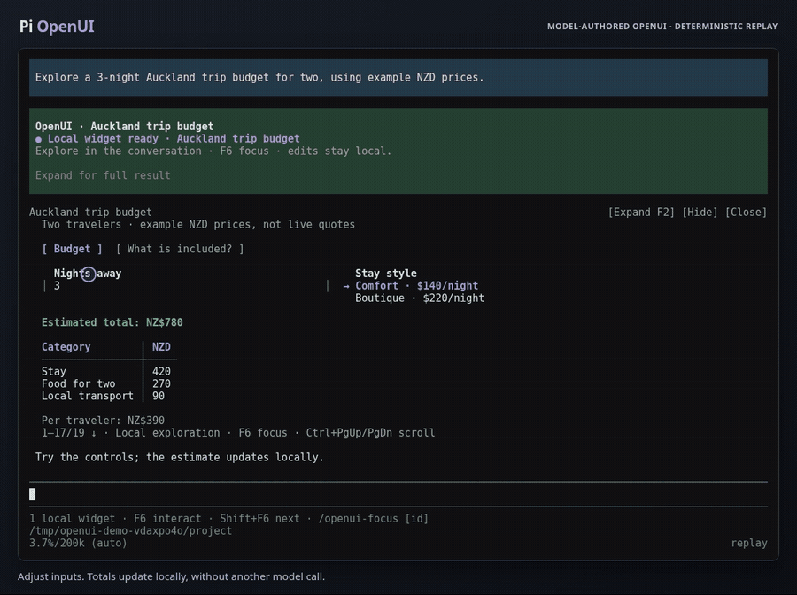

# Pi OpenUI

An OpenUI Lang extension for **Pi 1.4+**, using `@openuidev/lang-core` 1.0.2 and Pi's host-provided `@earendil-works/pi-tui`. No React, browser, webview, or separate terminal loop.

## See it in Pi

[](https://raw.githubusercontent.com/FireTheDevil/pi-openui/e0d5098221d2237bbc549641803704f9b8b271d6/media/openui-demo.mp4)

[Watch the 34-second video](https://raw.githubusercontent.com/FireTheDevil/pi-openui/e0d5098221d2237bbc549641803704f9b8b271d6/media/openui-demo.mp4) · [Demo source and recording notes](https://github.com/FireTheDevil/pi-openui/blob/e0d5098221d2237bbc549641803704f9b8b271d6/media/README.md)

Adjust a budget, browse tabs, expand the widget, then hide it to keep chatting and restore it with the edits intact. Recorded in actual Pi using a model-authored OpenUI document and deterministic provider replay; example prices are illustrative.

## Project status

This version is **fully vibe coded so far**: its implementation was generated with AI assistance. Automated checks and local testing do not guarantee correctness; review it for your use case and report issues on [GitHub](https://github.com/FireTheDevil/pi-openui/issues).

Tested on **Pi 1.4.0 and 1.5.0**: the automated and CLI checks in the [validation history](docs/validation-history.md) cover 1.4.0; local interactive testing also covers 1.5.0. Peer dependencies accept Pi 1.4+, but later versions have not yet been verified.

See the [versioning policy](docs/versioning.md) for future release conventions and compatibility expectations.

## Install

Requires Node.js 22.19+ and Pi with the `@earendil-works` package namespace (tested on Node 24).

Install the extension and bundled skill from [GitHub](https://github.com/FireTheDevil/pi-openui):

```sh
pi install git:github.com/FireTheDevil/pi-openui
```

Restart Pi or run `/reload` in an existing session, then try `/openui-demo --local`. Use `/openui-demo` for an answer-collecting form.

To install a specific branch or tag, replace `BRANCH_OR_TAG` with its name:

```sh
pi install git:github.com/FireTheDevil/pi-openui@BRANCH_OR_TAG
```

### npm (not yet published)

The package name is `@firethedevil/pi-openui`. After the first npm release, you can install it with:

```sh
pi install npm:@firethedevil/pi-openui
```

## Run from source

Requires Node.js 22.19+ and Pi with the `@earendil-works` package namespace (tested on Node 24).

```sh
npm ci --ignore-scripts
pi --tui-mode fullscreen -e ./src/index.ts --skill ./skills/openui/SKILL.md
```

In Pi, run `/openui-demo` or `/openui-demo --stream`. Choose a next step, enter instructions, then activate **Send to Pi**. Submission sends one structured action message to the active session and displays a themed receipt (queued as a follow-up if Pi is busy). Escape or Ctrl+C cancels; its receipt does not start another agent turn.

Run `/openui-demo --actions` to try buttons that update state without closing the panel: increment a counter, apply an ordered plan, reset the fields, and send the result to Pi. Add `--stream` to preview this demo incrementally; it remains read-only until complete.

Add `--fullscreen` to an answer-collecting demo to start expanded, or press F2 while it is open.

Run `/openui-demo --local` for the hosting-cost explorer or `/openui-demo --local-tabs` for a tabbed explanation with local disclosure. These return immediately, remain interactive in the conversation and keep chat available. Use F6 to move between chat and a widget, then F2 or its header control to expand/collapse within the transcript. The local demos do not accept `--stream` or `--fullscreen`.

Run `/openui-demo --catalog` to explore all **25 components** across Forms, Layout, Display and Advanced pages. Try the calendar, tree, multiline editor, workflow buttons and typed fields. Complete the required fields, then submit the result to Pi. See the [component reference](docs/components.md) and [actual Pi screenshots](docs/catalog-demo.md). This demo also accepts `--stream`.

To persist installation, run `pi install /absolute/path/to/pi-openui`. The package manifest registers the extension and its bundled `openui` skill. Pi supplies its own TUI at runtime; development dependencies are only for local checks.

Answer-collecting forms open inline in Pi's editor area, keeping conversation context visible. For exploration that needs no answer, `interaction: "local"` mounts an interactive transcript widget and leaves the composer available. For an answer-collecting form, press F2 to expand to fullscreen or return inline without losing edits. Pi's `--tui-mode fullscreen` routes mouse events to both layouts; `--tui-mode regular` retains keyboard interaction and leaves the mouse to the terminal. The host's TUI mode and an OpenUI document's presentation are separate settings.

## Agent tool

`show_ui({ source: "…", presentation: "auto" })` renders native terminal components. Choose its interaction contract:

| Need | Arguments | Outcome |
| --- | --- | --- |
| Static information | Display-only source; default interaction | Immediate `{"status":"displayed"}` with persistent transcript content |
| Local exploration without an answer | `interaction: "local"` and default/inline presentation | Immediate `{"status":"mounted","widgetId":"..."}`; an interactive transcript widget with chat still available |
| A choice for the agent | Default interaction or `interaction: "collect"` | A focused form waits for submission or cancellation |

`presentation` accepts `auto`, `inline` or `fullscreen`; local mode rejects fullscreen. Removing Submit from a default form does not make it nonblocking. The extension adds lang-core's generated component prompt to Pi's system prompt while the tool is active in TUI mode.

```text
$choice = "Review";
$note = "";
root = Stack([
  Text("Selected: " + $choice),
  Select("choice", "Next step", ["Review", "Implement", "Test"], $choice),
  Input("note", "Instructions", $note, "Optional note"),
  Table(["Task", "Status"], [["Design", "Ready"], ["Tests", "Pending"]]),
  Button("Send to Pi", "next_step")
]);
```

| Family | Components |
| --- | --- |
| Fields | Input, Select, Checkbox, MultiSelect, TextArea, NumberInput, Toggle, Slider, DatePicker, Tree |
| Layout and navigation | Stack, Row, Section, Card, Tabs, Steps |
| Display | Text, Markdown, CodeBlock, List, Badge, Progress, Table, Divider |
| Actions | Button |

Use a `Stack` root and declared state variables of the appropriate type for form bindings. Values remain strings, booleans, numbers or string arrays through editing and submission. The [component reference](docs/components.md) lists every positional signature and setting; the original six signatures remain compatible. Editing fields uses lang-core's store and re-evaluates dependent expressions. A submitting collect-mode button returns a tool result such as:

```json
{"status":"submitted","action":"next_step","state":{"$choice":"Test","$note":"Check resizing"},"values":{"choice":"Test","note":"Check resizing"}}
```

Submission continues the current agent turn without injecting a duplicate user message. Escape or Ctrl+C closes the form and returns `{"status":"cancelled"}` as a normal tool result. The caller resumes and decides what to do next; the extension does not abort the run, terminate a cell or restart the notebook. Invalid documents return an error with diagnostics. RPC, JSON and print modes return an explicit unsupported-mode error.

Use inline displays for tables, explanations and code excerpts that need no acknowledgement. Use `presentation: "fullscreen"` for an explicitly requested expanded view or dense inspection. In a fullscreen display-only document, Enter closes the view and leaves the content inline; Escape returns a cancelled result. This does not add chart or Mermaid components to the catalog. See [inline presentation and cancellation](docs/inline-ui.md).

Use local widgets for calculators, comparisons, Tabs, Trees and expandable explanations when no result is needed by the agent. F6 transfers focus between chat and the widget; Shift+F6 cycles widgets. F2 or the header control expands/collapses a local widget within the transcript. Escape/Ctrl+C returns focus to chat, while `/openui-close [id]` dismisses one. Edits, expansion, reset, blur, later chat and dismissal never send values to the model or start a tool. Only Set/Reset actions and local sequences are accepted. Widgets keep independent live state across turns; reopening or replaying a session restores original defaults, visible and compact, rather than edited values or presentation state. See [local interaction, lifecycle and the hosting explorer](docs/local-interaction.md).

Hide, beside Close, reduces a local widget to a one-line placeholder while retaining its live values, drafts, tab/step, scroll position and expanded height. Restore resumes that widget; Close permanently dismisses it. Keyboard users can run `/openui-hide [id]` and `/openui-restore [id]`; restore without an ID selects the most recently hidden widget. Hidden widgets leave the status hint and F6/Shift+F6 cycle, but their Restore action remains in the transcript. Hiding and restoring never submit values or start model/tool calls.

## Submission summaries

After the form closes, Pi displays a themed receipt with readable field labels and choice names. Submitted, cancelled and error outcomes have distinct status styling. Receipts follow Pi's active theme, wrap on narrow terminals, and show a compact selection of fields. Expand tool details (Ctrl+O by default) to inspect all receipt fields and the full structured result.

Optionally choose the receipt title and field order:

```js
show_ui({
  source,
  summary: { title: "Review configuration", fields: ["owner", "checks", "retries"] }
});
```

`summary.fields` contains field names, not labels or `$variables`; unknown names are ignored. Without it, the receipt uses document order and omits Tabs/Steps navigation. Booleans render as Yes/No and rich selections use their labels. These hints affect presentation only: `content` and `structuredContent` still contain the complete original outcome, including every submitted value, state and context. Display metadata is kept separately in `details.openuiReceipt`.

Direct tool calls render the receipt in their tool result. Native code-mode calls display a separate persistent receipt in the transcript. For completed scripts containing only known OpenUI results, the code block collapses to a short execution summary; expansion restores the original code and output. Mixed scripts retain their other calls and output. Only an exact known result is hidden from the compact display. Cancellation and errors never fabricate submitted values, and a submitted receipt confirms input was received, not that any requested external work was performed.

See the [submission summary screenshots](docs/submission-summaries.md) for actual Pi captures and verification details.

## Model guidance

The extension automatically supplies lang-core's component schemas, binding/action rules, core interaction policy and examples whenever `show_ui` is active in TUI mode. The bundled [openui skill](skills/openui/SKILL.md) teaches when to use prose, a static display, nonblocking local exploration, an answer-collecting form or expanded inspection; how to compose comparisons, decisions and scenario explorers; and how to choose among the 25 components. It covers grounded data, meaningful reactive state, layout, cancellation, validation, code/notebook execution and useful submission receipts. Complete examples distinguish local recalculation/reset from explicit answer collection and submission.

Package installation makes the skill discoverable. Pi loads its detailed instructions on demand; `/skill:openui` explicitly loads it. When running only the extension file with `-e`, add `--skill ./skills/openui/SKILL.md` as in the command above. Keep `read` or `bash` available if you use a restricted tool list: Pi omits skill discovery from the model prompt when neither tool is callable. The generated component prompt remains available independently of skill loading.

The extension works through Pi's normal model/tool loop; the deterministic provider is external test tooling. See the [real-model evaluation guide](docs/model-evaluation.md) for the architectural contract, realistic acceptance prompts and the boundary between verified integration and model-generation quality.

## Native code mode

Pi's native `codemode` can call the same tool while the session is in interactive TUI mode. Enable it alongside `show_ui`, for example:

```sh
pi --tui-mode fullscreen --tools +codemode -e ./src/index.ts --skill ./skills/openui/SKILL.md
```

A model's `codemode` script can then await a structured result:

```js
const result = await tools.show_ui({
  source: 'root = Stack([Button("Continue", @ToAssistant("Continue with the plan"))]);',
  summary: { title: "Plan confirmation" }
});
text(result);
```

In collect mode, the promise stays pending while the user edits fields or runs local actions and returns typed data on submission. Local mode returns `status: "mounted"` immediately after installing the transcript widget; the cell can finish while the widget stays interactive. Display-only inline documents return `status: "displayed"` immediately. Cancelling the form resolves the promise with `status: "cancelled"`, so code following the await can handle the result normally. Check the status before using submitted values; form cancellation does not stop the cell or discard notebook state. Results also distinguish `cancelled` and `error`, and only `submitted` contains user choices. Native code mode receives the tool's structured output; normal tool calls retain their JSON text result. Avoid short script deadlines and concurrent answer-collecting forms; multiple local widgets have independent state. A nested result reaches the model only when the script outputs it.

This works with native `codemode.mode` set to `on` or `only`. Keep `show_ui` active: `--tools codemode` alone removes it; use `--tools +codemode` or `--tools codemode,show_ui`. A UI invoked inside JavaScript opens when `tools.show_ui()` executes; partial JavaScript source does not produce a UI preview. Direct `show_ui` calls still support incremental argument previews.

The third-party Code/Notebook Mode in `@howaboua/pi-codex-conversion` 4.0.7 exposes the same `await tools.show_ui(...)` call through its tool bridge and returns this tool's structured result. OpenUI keeps a collect-mode call attached to the enclosing execution while waiting for input, including after a yield budget expires. Local-mode calls finish after mounting and do not wait for user interaction. The enclosing execution tool and persistent notebook lifecycle differ from native `codemode`. Cancelling a form returns normally in Code, Deno Notebook, JavaScript Notebook and TypeScript Notebook modes; it requires no notebook restart. See [mode compatibility and cancellation](docs/inline-ui.md#execution-modes) for configuration, tested execution paths and result handling. Native code mode and `/openui-demo` need no such package.

OpenUI Lang accepts host-defined component libraries. These are terminal-specific schemas, not drop-in replacements for the differently shaped components in OpenUI's web libraries.

The catalog is defined with Zod schemas supplied to lang-core. It covers terminal forms, layouts, navigation and structured output; it does not implement every component in OpenUI's separate web libraries. Charts, media, rich document editing and browser-specific interactions remain outside this catalog.

## Appearance

All components use Pi's current theme: accent titles and selections, bold field labels and table headers, highlighted focused buttons, input boundaries, muted hints and error colors. Text supports semantic tones, bold and italic; buttons support primary, secondary and danger variants. Theme changes are reflected by the open view. Inline forms use a bounded, left-aligned area so the conversation remains visible. Fullscreen views center content up to 96 columns wide. Rows stack vertically on narrow terminals, tables adapt to available space, and the footer shortens its hints. Mouse targets follow nested layouts, content insets and resizing. Only the focused editor shows a cursor.

Use Pi's normal theme selection, for example `pi --use-theme dark --tui-mode fullscreen -e ./src/index.ts` or `--use-theme light`. See the [theme gallery](docs/themes.md) for actual terminal captures.

## Button actions

Buttons accept lang-core action expressions. Local actions re-evaluate dependent Text, Table and field values without closing. In collect mode, existing string action identifiers still submit and close. Local widgets reject string submissions and ToAssistant, including hidden/conditional paths; their Action sequences may contain only Set/Reset.

```text
$count = 0;
$note = "";
root = Stack([
  Text("Count: " + $count),
  Input("note", "Note", $note),
  Button("Increment", @Set($count, $count + 1)),
  Button("Reset", @Reset($count, $note)),
  Button("Increment and send", Action([
    @Set($count, $count + 1),
    @ToAssistant("Review this", {count: $count, note: $note})
  ]))
]);
```

| Action | Behavior |
| --- | --- |
| `@Set($variable, expression)` | Evaluate against current state and update a declared variable |
| `@Reset($variable, ...)` | Restore the named variables to their document defaults |
| `@ToAssistant(message, context)` | Submit current values and state, plus the message and optional context, then close |
| `Action([...])` | Execute supported steps in order; submission must be the final step |

`@ToAssistant` returns `status: "submitted"` and `action: "continue_conversation"`, with `message`, optional `context`, `state` and `values`. For `show_ui`, this completes the waiting tool call so Pi can continue. The demo delivers the same structured result through one themed session message.

Plans are limited to 32 steps and may only target declared variables. Steps see preceding state changes; the plan commits only if the resulting UI is valid, otherwise all its changes roll back. Unsupported actions, such as `@Run`, `@OpenUrl` or custom host actions, produce explicit errors. Query and Mutation are not implemented. Action failures appear in the panel so the user can correct fields or cancel. All action execution remains disabled while streaming.

For buttons generated by `@Each`, a plan that changes its own list or button identity before submitting can be rejected and rolled back. Use separate local-update and submit buttons for that case.

See the [action demo screenshots](docs/action-demo.md) for native rendering, local updates, reset and submission in the actual Pi CLI.

## Interaction and streaming

When a form or widget is focused, Tab / Shift+Tab moves between controls; arrows navigate choices, pages, calendars and trees. Enter confirms a select or advances from an input; Enter / Space activates a focused button. Space toggles checkboxes and multiple selections. TextArea uses Enter for a newline and Ctrl+Enter to advance. In collect mode, F2 expands or collapses a form, preserving values, draft text and focus. In local mode, F6 transfers focus to/from chat and Shift+F6 cycles widgets; F2 or the Expand/Collapse header control changes the widget's height within the transcript while chat remains available. Compact height stays the default; an overflow range and arrows expose hidden content at either height. PgUp / PgDn scrolls long content or changes the focused calendar's month. In local widgets, use Ctrl+PgUp / Ctrl+PgDn: the fullscreen host reserves plain paging for the transcript. Text wraps at the current width, tables switch to labeled records on narrow terminals, and focus follows the selected control on resize. See the [control key reference](docs/components.md#keyboard-and-mouse) for details.

With Pi's fullscreen TUI, click a select option, click an input to position its cursor, or click a button to run its action in either inline or fullscreen presentation. Labels focus their controls. The wheel changes selection over a select list and scrolls the view elsewhere. Mouse targets track wrapping, scrolling and resizing; streaming previews cannot edit or submit by mouse or keyboard.

Fields support descriptions, required values, disabled states and explicit errors. Validation keeps the form editable while blocking submission, including errors on inactive Tabs/Steps pages; submission reveals and focuses the invalid field. Hidden pages retain their values and participate in reset and submission. Disabled fields are skipped during focus and validation but their values are still returned; disabling Tabs or Steps also disables its descendants. A numeric draft stays visible while invalid and cannot silently submit an older number.

Completed documents are parsed and validated before interaction. For explicit collect-mode calls from providers exposing incremental tool arguments, `message_update` feeds accumulated `source` text to lang-core's streaming parser and updates the same `ctx.ui.custom()` view. Local mode waits for complete validation before mounting; an unknown interaction mode must not seize the composer while arguments arrive. Inputs and submission remain disabled until tool execution validates the final document. `/openui-demo --stream` exercises this path deterministically with timed chunks. Providers without partial arguments show the completed document normally.

While a collect-mode form has focus, Escape and Ctrl+C close it and return an ordinary cancelled result. The caller can branch on that result without losing notebook variables or restarting a kernel. In a local widget, those keys return focus to chat without dismissal or another tool result. A separate tool/session abort, timeout, interrupted generation or shutdown still cleans up the view through the host's normal lifecycle. Cancelling a preview prevents that tool call from reopening it. Only one interactive view owns keyboard focus at a time; multiple local widgets may remain mounted alongside chat.

Malformed source, unresolved references, invalid props, duplicate field names and unsupported components produce diagnostics. Documents are limited to 65,536 characters, 256 components, 32 levels, 200 table rows/options and 20 columns. Model text is stripped of terminal control sequences. Buttons can update local state or return structured data to Pi; they do not execute external tools or scripts.

## Development

```sh
npm run typecheck
npm test
```

`src/catalog.ts` defines the Zod component specifications and generated model prompt. `src/model.ts` owns parsing, evaluation, typed state, validation and action dispatch. `src/view.ts` composes layouts and routes focus and pointer events; `src/controls.ts`, `src/displays.ts` and `src/presentation.ts` implement widgets, content and theme handling. `src/inline-document.ts` renders persistent display-only documents. `src/local-widgets.ts` manages persistent local widgets and their focus/lifecycle; `src/local-policy.ts` rejects nonlocal actions; `src/local-demo.ts` supplies the hosting explorer and tabbed explanation. `src/summary.ts` renders receipts; `src/code-summary.ts` persists native code-mode content/receipts and adapts its transcript display. `src/conversion.ts` supplies optional blocking-call metadata through the conversion package's public extension-tool protocol. `src/index.ts` owns Pi registration and view lifecycle. Automated tests exercise real lang-core and Pi widgets, hidden-page validation, actions, malformed/streaming input, resizing, receipt data preservation, session branches, skill discovery, Pi's actual extension loader, its fullscreen mouse decoder, and native codemode's QuickJS worker, using simulated host/terminal boundaries.

Validation includes core tests, runtime compatibility checks and actual Pi CLI sessions using a deterministic provider, not external model generation. See the [validation history](docs/validation-history.md) for release results, coverage limits and links to reproduction instructions.
