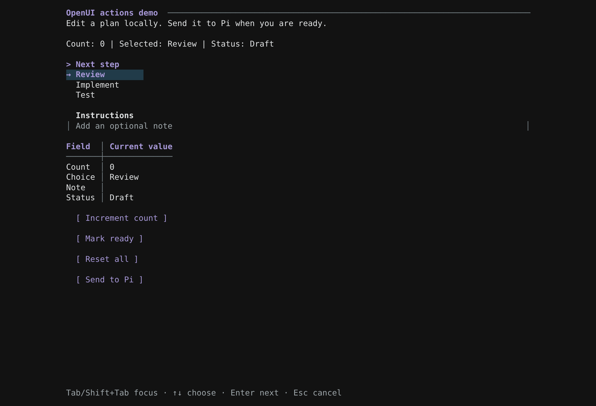
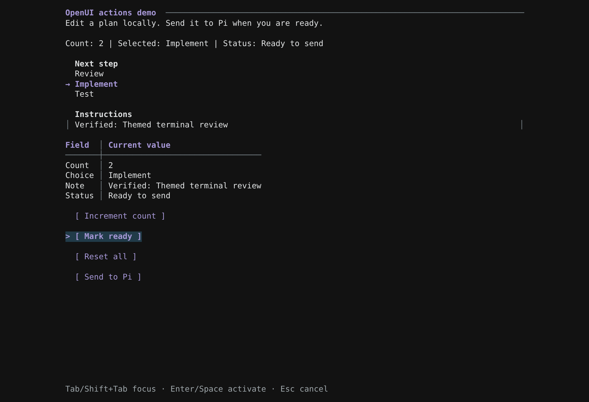
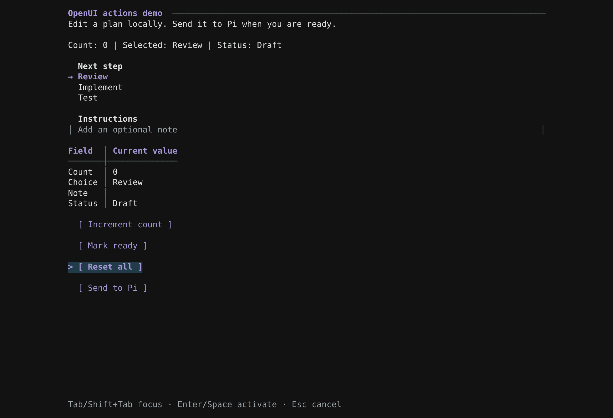
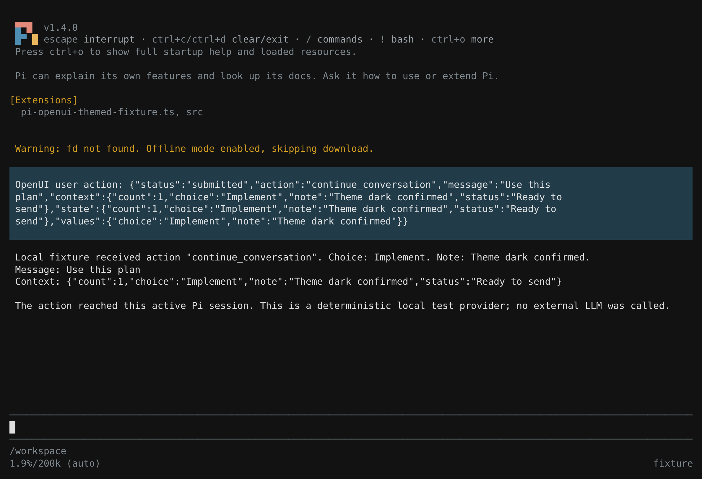

# Native action demo

Run `pi --tui-mode fullscreen -e ./src/index.ts`, then `/openui-demo --actions`.

These images capture the actual Pi 1.4.0 CLI in a POSIX PTY. The unchanged terminal output was replayed into xterm.js for screenshots. Browser tooling was used only to capture images; the extension renders through Pi's native TUI. A deterministic local provider verified session delivery without calling an external LLM.

## Initial components

Text and a vertical Stack contain a native Select and Input, a reactive Table, and four Buttons. Tab / Shift+Tab moves focus; arrows choose an option; typing edits the input. Fullscreen mode also accepts mouse clicks.

## Local actions and reactive rendering

After editing the input, incrementing with keyboard and mouse, and clicking **Mark ready**, the Text and Table show the latest state. Mark ready runs two ordered `@Set` steps. These actions keep the panel open and send no message to Pi.

## Reset

Clicking **Reset all** runs `@Reset($count, $choice, $note, $status)`. The counter, selected option, input and status return to their defaults while the panel stays open.

## Submit to the active session

After reset, the test enters a new note, increments the counter, marks the plan ready and clicks **Send to Pi**. `@ToAssistant` closes the panel and sends the current message, context, state and field values. Pi regains input focus and the local provider acknowledges the result below. For an agent-created `show_ui`, the same result completes its waiting tool call.

Streaming remains read-only until completion. Unsupported actions and invalid resulting state produce an inline error; failed plans leave the original state intact. Escape cancels without submitting.
