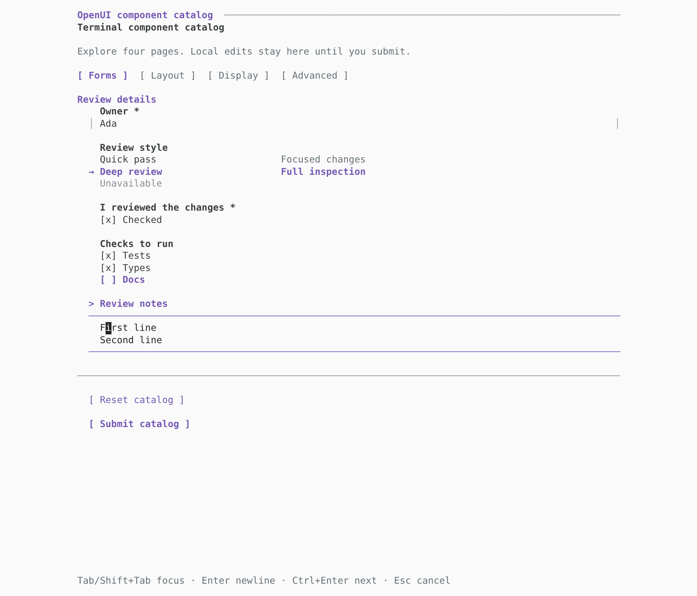
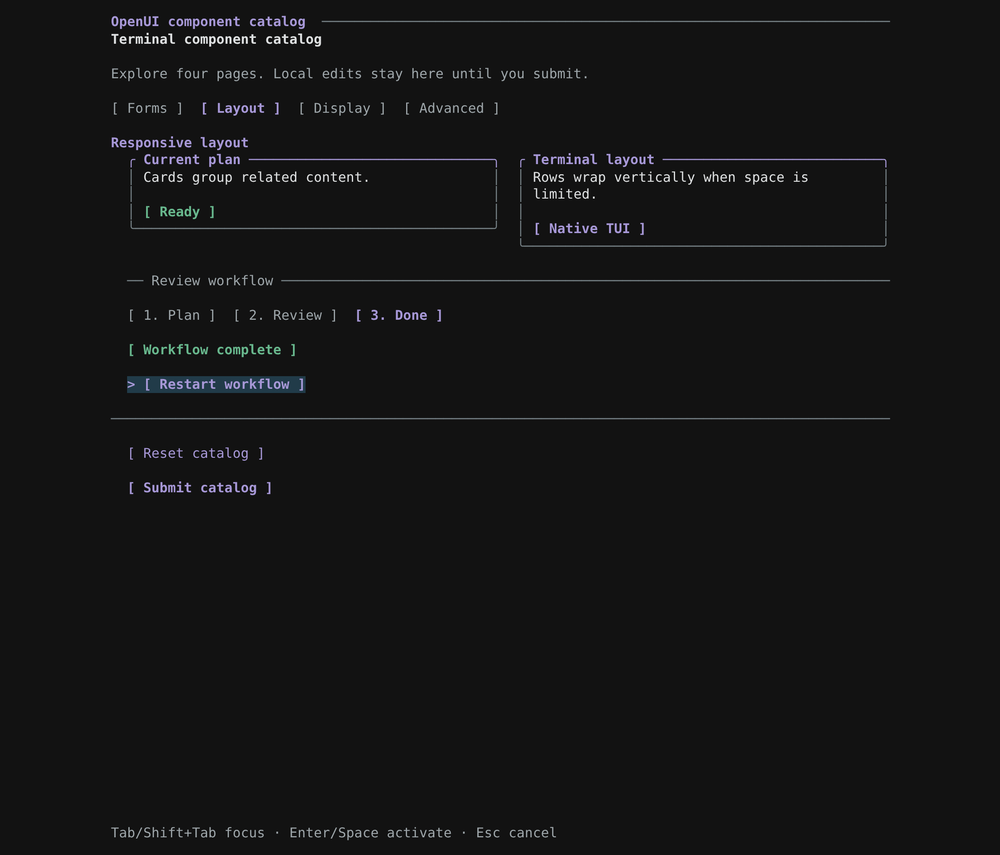
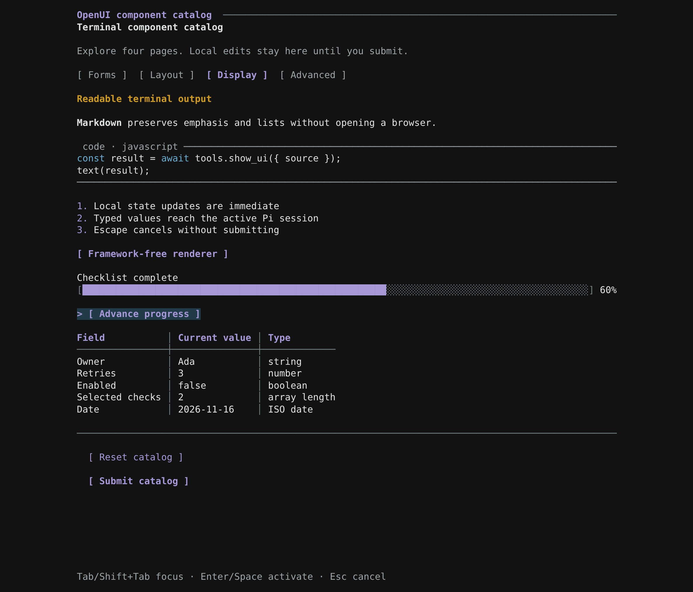
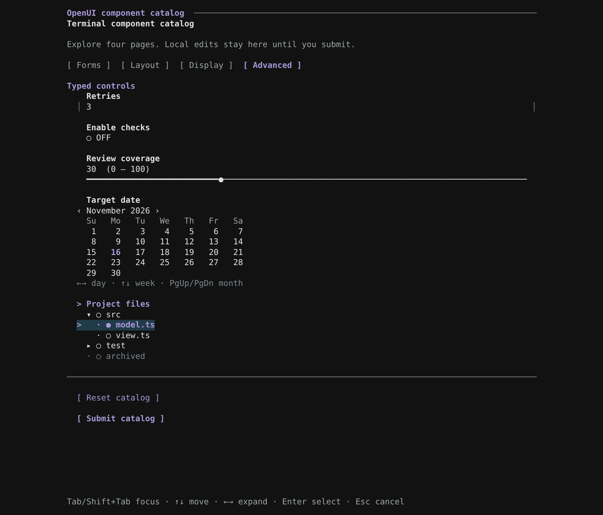
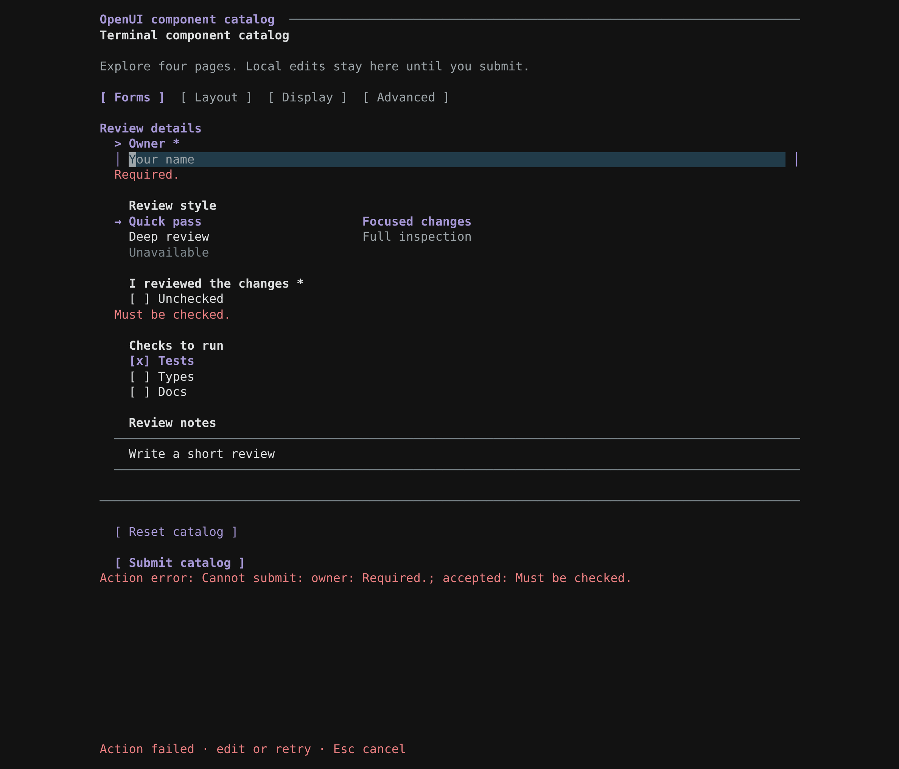
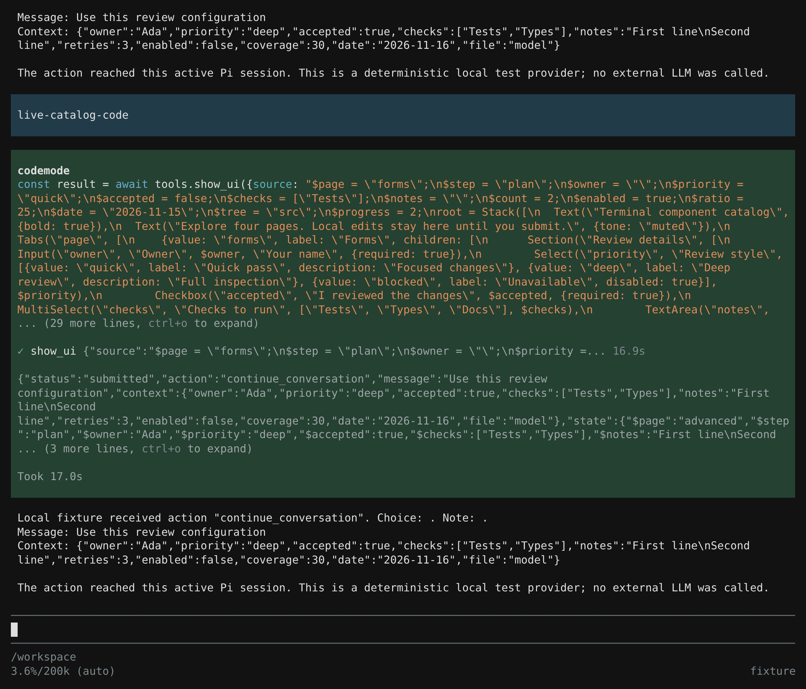

# Component catalog in the actual Pi CLI

Run `/openui-demo --catalog` in Pi 1.4+ to explore all 25 terminal components. Add `--stream` to preview the same document incrementally. The [component reference](components.md) documents every signature, setting and key binding.

These captures came from real Pi 1.4.0 fullscreen sessions in a Linux PTY on Node 24. Both dark and light runs passed keyboard and mouse editing, validation, local actions, resizing, streaming, cancellation and submission through native code mode. A deterministic local provider received the results; external model providers were not tested. The screenshot harness replayed unmodified terminal output. It is separate from the extension, which has no browser dependency.

## Forms

Input, rich Select options, Checkbox, MultiSelect and TextArea after editing, using Pi's light theme. Space toggles choices; the multiline editor uses Enter for a newline and Ctrl+Enter to advance. Disabled choices ignore clicks.



## Layout and workflow

Row places Cards beside each other when space permits. Tabs switch pages, while Steps tracks a workflow. The demo's buttons use local `@Set` actions to advance it without closing the panel; Reset restores all pages. Rows stack vertically when their children no longer fit.



## Formatted output

Markdown, highlighted CodeBlock, List, Badge, Progress and Table use Pi's current theme. The focused button advanced the progress indicator locally; the table reflects the edited typed state.



## Advanced controls

NumberInput, Toggle, Slider, DatePicker and Tree after keyboard and pointer edits. The calendar supports day/week arrows, month paging and clicking dates. Tree arrows expand branches; clicking a node selects its value.



## Validation

Submitting with an empty required Owner or unchecked confirmation keeps the panel open and focuses the invalid field. Validation also checks inactive pages and opens the page containing an error. Invalid numeric drafts remain editable and block submission rather than silently returning a previous value.



## Native code-mode result

Pi's native code-only QuickJS worker awaited `tools.show_ui(...)`, received the typed result and returned it to the active session. The direct demo command produced the same context:

```json
{
  "owner": "Ada",
  "priority": "deep",
  "accepted": true,
  "checks": ["Tests", "Types"],
  "notes": "First line\nSecond line",
  "retries": 3,
  "enabled": false,
  "coverage": 30,
  "date": "2026-11-16",
  "file": "model"
}
```



The live checks also verified parent tool-call IDs, prompt availability, exactly one result per submission, and cancellation. Streaming stays read-only until the complete document is validated, as in earlier versions.
