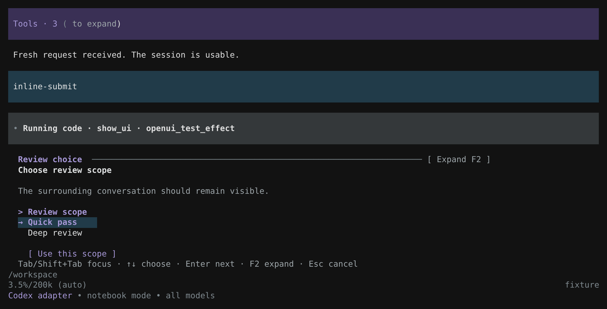
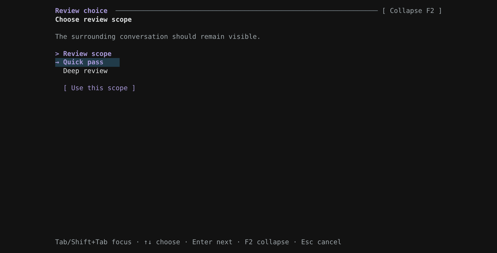
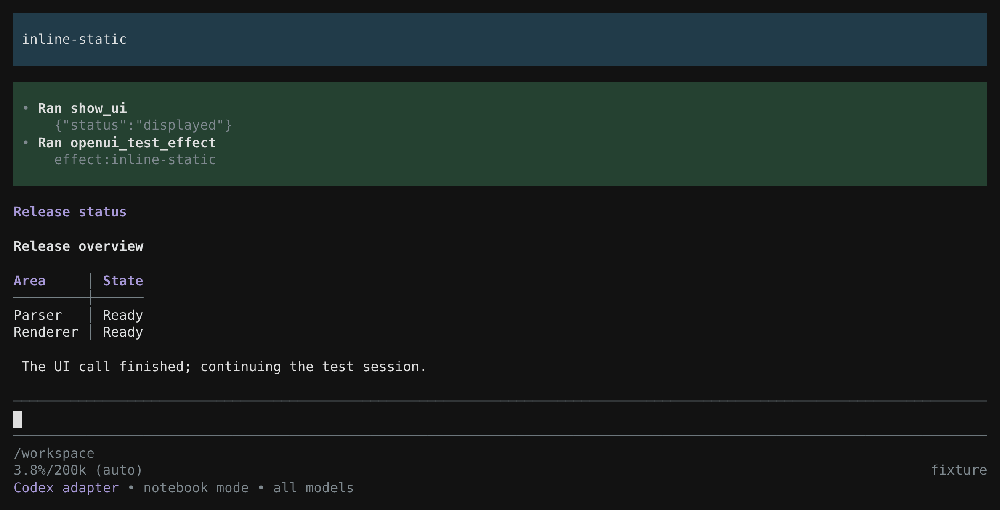
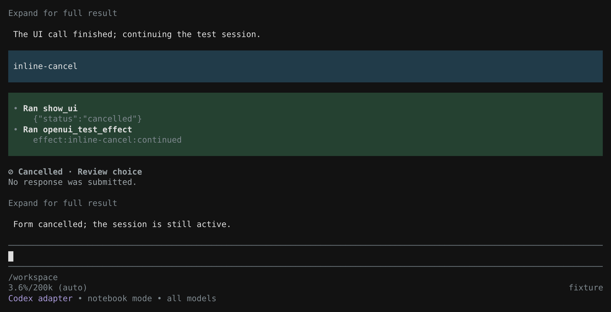

# Inline presentation and cancellation

`show_ui` uses inline presentation by default. Its behavior depends on the document:

| Document | Default behavior | Result |
| --- | --- | --- |
| Display components only, such as Text, Table, Markdown or CodeBlock | Render persistent content in the conversation without taking keyboard focus | `status: "displayed"` |
| Fields, Tabs/Steps navigation or buttons | Focus a compact native view in Pi's editor area while leaving conversation context visible | Typed `submitted` result after a final action |
| Explicit `presentation: "fullscreen"` | Open an expanded view for inspection or interaction | Submission for a form; Enter closes display-only content and leaves it inline |

`presentation: "auto"` and `"inline"` both prefer inline content. Choose fullscreen when the user asks to expand something or sustained inspection needs the space. The component catalog is unchanged: fullscreen does not add a chart, Mermaid or browser renderer.

For example, a table can be shown without an acknowledgement button:

```js
const result = await tools.show_ui({
  source: 'root = Stack([Text("Supplied test results", {bold: true}), Table(["Suite", "Passed"], [["Unit", 24], ["Integration", 8]])]);',
  presentation: "inline",
  summary: { title: "Test results" }
});
text(result); // {status: "displayed"}; no user decision was requested.
```

The example uses Pi's native code-mode invocation syntax. Direct tool calls pass the same arguments. The conversion adapter described below also exposes `tools.show_ui`; other adapters may expose a different invocation API.

## Actual Pi captures

These captures use Pi 1.4.0 with conversion Deno Notebook Mode and the dark theme. The inline choice keeps the preceding conversation and running-cell context visible. The focused selection is “Quick pass”; arrows change it, Tab moves to the submit button, and F2 expands the same view.



F2 opens the same form fullscreen. Collapse returns to the inline layout without submitting or resetting the selection.



This display-only table returned `displayed` without waiting for acknowledgement. The capture was taken after closing and reopening the actual Pi session: the rendered table persisted, and the prompt is ready for input. “Release status” and the sentinel tool are fixed test content, not a report about an external release.



Cancelling this notebook form returned `status: "cancelled"`. The receipt is followed by the caller's continuation and the model's normal acknowledgement; no notebook restart or host-abort error occurred. The continuation marker is test-only and does not represent work performed from an unsubmitted choice.



## Interaction and expansion

An inline form still takes keyboard focus and waits for input; it is not a background widget competing with the prompt editor. Tab, arrows and Enter work as usual. F2 expands the current interactive view or returns it inline, preserving values, draft text, focus and local state. Expansion does not submit the form or create a second tool call.

Pi's host mode and OpenUI presentation are separate choices. `pi --tui-mode fullscreen` enables the host's mouse routing for both inline and expanded OpenUI views. `pi --tui-mode regular` supports keyboard interaction and leaves mouse handling to the terminal. Resizing reflows content and adjusts the inline viewport; large forms scroll rather than covering the entire conversation by default.

After submission, the compact form is replaced by its themed receipt. The complete typed result remains available to the caller. Display-only content remains as rendered content rather than an invented submission receipt. Long inline displays have a compact preview; expand transcript details with Pi's usual shortcut (Ctrl+O by default) to see the complete document. F2 applies while an interactive or expanded inspection view is open. Native code-mode presentation metadata is stored separately from model-visible output, so scripts should still emit data the model needs.

## Cancellation

While an OpenUI view has focus, Escape or Ctrl+C closes it and resolves `show_ui` with `{"status":"cancelled"}`. This is an ordinary tool result, like a submission outcome. It does not abort the Pi run, terminate the current cell or stop the notebook kernel. The waiting caller resumes and can decide what to do next.

A cancelled result contains no submitted `values`, `state` or `context`. Check the status before using answers or performing work that depends on them. For example:

```js
const result = await tools.show_ui({ source });
if (result.status === "submitted") {
  text(result.values); // use these answers for the requested work
} else if (result.status === "cancelled") {
  text("Form cancelled; no choice supplied.");
} else {
  text(result); // displayed content or validation diagnostics
}
```

The caller may continue independently authorized work after handling cancellation. Do not substitute defaults for a submitted answer or automatically reopen the dismissed form. Cancellation closes the form without rolling back earlier notebook changes or external effects.

Closing a fullscreen display-only document with Enter returns `displayed` and leaves the content inline. Escape returns `cancelled`. F2 collapse of that display-only view also returns it to persistent inline content.

A separate host stop, tool timeout, session abort or shutdown follows the host's normal cancellation lifecycle and releases the view and listeners. Those operations are independent of dismissing a form. Cancelling `/openui-demo` records a receipt without submitting a synthetic user action or starting an extra model turn.

## Execution modes

Normal Pi invokes `show_ui` directly. Native Pi code mode invokes `await tools.show_ui(...)` and receives structured output in `on` and `only` configurations; keep the underlying tool callable. Code-only configuration changes tool exposure, not the native rendering path.

`@howaboua/pi-codex-conversion` 4.0.7 exposes `await tools.show_ui({...})` through the same bridge in its Code and Notebook runtimes. Because `show_ui` declares an output schema, the bridge returns structured output, including `status` and submitted typed fields. Its enclosing `exec` tool and persistent notebook lifecycle are separate from native Pi `codemode`. Use unique top-level bindings or reuse existing ones in a notebook; a second `const result` in the same kernel can be a redeclaration error.

OpenUI also registers the callable as blocking through the conversion package's public extension-tool protocol. This keeps the enclosing execution waiting for the UI result even after the cell's yield budget expires. Submission and cancellation both resolve the UI call normally; ordinary script execution and yielding can then resume. Other tools retain the adapter's ordinary scheduling. This integration adds no conversion-package runtime dependency and does not patch its globals or runtime.

Configure the adapter through `/codex` and its General execution-mode setting. An isolated test agent directory can instead contain `pi-codex-conversion.json`:

```json
{
  "executionMode": "notebook",
  "scope": { "allProviders": "on" }
}
```

Use `"code"` for Code Mode. The directory is Pi's configured agent directory (`PI_CODING_AGENT_DIR` when explicitly set). Load the adapter and this extension in the same interactive Pi session. This file configures the conversion adapter; it does not select Pi's native `codemode`.

Both presentation choices are implemented at the shared `show_ui` boundary. Form cancellation is a normal result in conversion Code, Deno Notebook, JavaScript Notebook and TypeScript Notebook modes. Live notebook variables remain available to the caller and later cells; no restart is required because the form was dismissed. Explicitly stopping a cell or the host is a separate operation with its own runtime lifecycle.

For evaluation, run each mode with an observable operation immediately after the awaited UI. Both submission and form cancellation should reach it with their corresponding status. Guard a separate answer-dependent operation so only a submitted result reaches it. Verify that malformed documents return diagnostics and that notebook variables survive a cancelled form without a restart. See the [model evaluation guide](model-evaluation.md) for generation-quality checks and the distinction between a deterministic test provider and an external model.

## Repeat the adapter checks

The conversion package is an optional integration, not an extension dependency. Its runtime tests use a separately installed 4.0.7 package and an isolated Pi agent directory:

```sh
OPENUI_PCC_PACKAGE=/absolute/path/to/pi-codex-conversion \
PI_CODING_AGENT_DIR=/absolute/path/to/isolated-pi-agent \
OPENUI_PCC_MODES=code,notebook,js,ts \
npm run test:compat
```

These checks execute the real conversion runtimes with a simulated terminal/session boundary. All four modes run by default; `OPENUI_PCC_MODES` can restrict the set. They exercise inline displays, local state changes and typed submission, cancellation returned to the waiting caller, continued execution and preserved notebook state. Actual CLI tests complement them by checking the full extension registration and terminal lifecycle. Neither kind of test measures external-model generation quality.

All 28 runtime compatibility tests passed with Pi 1.4.0, Node 24.19 and conversion 4.0.7: Code used Rust v0.163.0; Deno Notebook used Deno 2.9.8; JavaScript Notebook used quickjs-wasi 3.6.3; TypeScript Notebook used tsrs 0.20.0-ts7.1.0-beta. Cancellation cases included a UI open beyond its requested yield budget and a UI opened by `wait` on a previously yielded cell. Each returned `cancelled` and resumed its caller exactly once without requesting a host abort. Deno, JavaScript and TypeScript tests retained variables and closures modified before dismissal and reused them in a later cell without restarting.

## Verified CLI paths

The v0.6.1 cancellation and inline presentation checks passed in six actual Pi 1.4.0 CLI configurations with Node 24 and a deterministic local provider:

| Execution path | Pi host TUI | Theme | Result |
| --- | --- | --- | --- |
| Direct `show_ui` | Fullscreen | Light | Passed |
| Native code mode `on` | Fullscreen | Dark | Passed |
| Native code mode `only` | Fullscreen | Dark | Passed |
| Conversion Code Mode | Fullscreen | Light | Passed |
| Conversion Deno Notebook Mode | Fullscreen | Dark | Passed |
| Direct `show_ui` | Regular | Dark | Passed |

The conversion runs used `@howaboua/pi-codex-conversion` 4.0.7, its Rust runtime v0.163.0 and Deno 2.9.8. The adapter's alternative TypeScript/JavaScript notebook backends were not part of this CLI matrix.

Every configuration verified Escape from an inline form and Ctrl+C from a fullscreen form returning ordinary cancellation results. Direct calls returned to the model; code callers handled the result and continued normally. An answer-dependent action guarded by `status === "submitted"` was skipped after cancellation. Later UI calls worked without a restart, and the transcript showed no host-abort error.

The conversion Code and Deno Notebook runs kept both cancellation forms open beyond a one-second yield budget. Each caller continued exactly once; an explicit `wait` on the completed original cell did not repeat that continuation.

The rendering checks covered inline context, resize to 68×28, F2 expansion/collapse, typed submission, explicit fullscreen presentation, a nonblocking static display and malformed source. Fullscreen-host runs used actual terminal mouse input; the regular-host run used keyboard input.

A separate gallery run verified that display-only content survived closing and reopening the actual Pi session. The screenshots show rendering, interaction and ordinary cancellation-result handling.

The screenshots replay unmodified PTY output from these runs. Browser tooling is used only by the external screenshot harness, not by the extension. No external model provider was used; these runs prove runtime integration, not model-generated UI quality.
