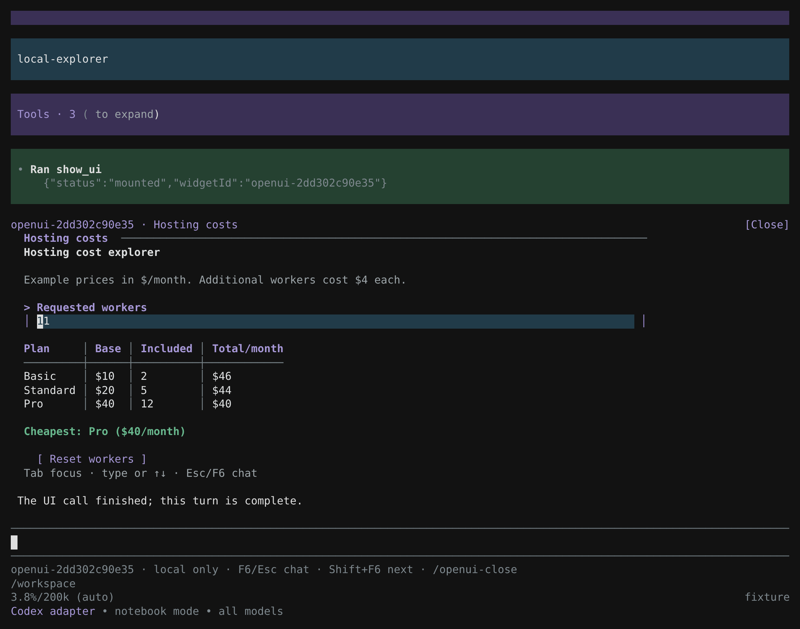
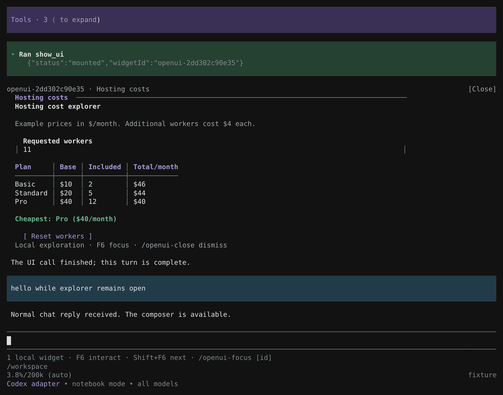
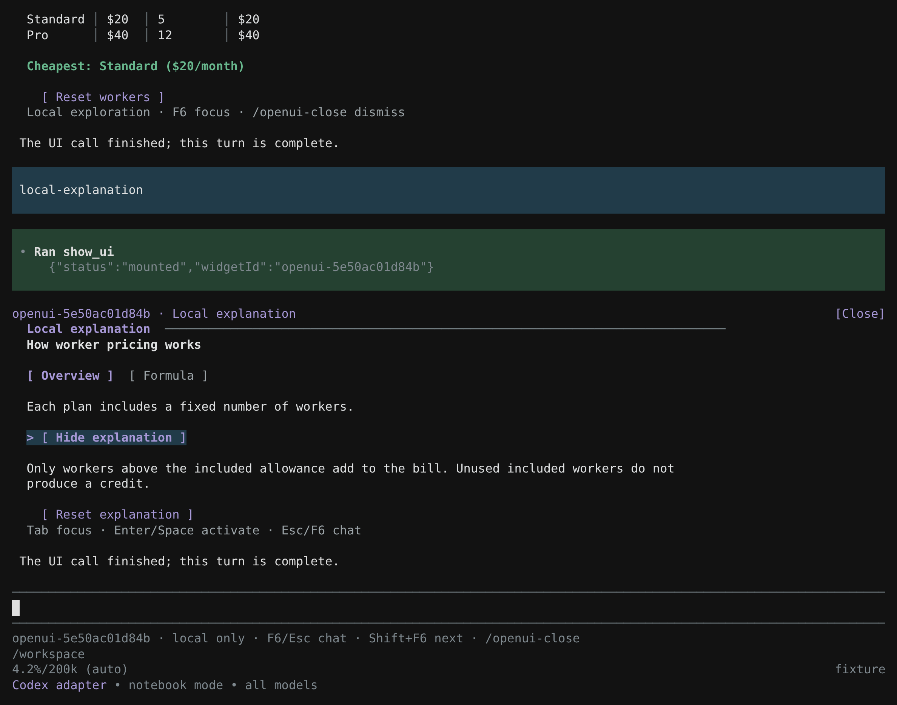

# Local interactive widgets

Use `show_ui({source, interaction: "local"})` when the user should explore an explanation, comparison or calculator without supplying an answer to the agent. The complete document mounts as a persistent conversation entry. The normal chat composer stays in place, and the call returns immediately:

```json
{"status":"mounted","widgetId":"..."}
```

This result means a widget was installed. It is not approval, a submitted answer or a final chosen value. It has no `values`, `state` or action context. The enclosing code/notebook cell can finish, the model can continue, and later chat messages do not freeze or dismiss the widget.

## Choose the contract

| Need | Arguments | Result and focus |
| --- | --- | --- |
| Static information | Display-only source; default interaction | `displayed`; rendered in the transcript without taking focus |
| Local exploration | `interaction: "local"`; `presentation: "auto"` or `"inline"` | `mounted` with `widgetId`; interactive transcript entry, composer remains available |
| An answer for the agent | Default interaction or `interaction: "collect"` | Focused form waits for `submitted` or `cancelled` |

Removing a Submit button from a default form does not make it nonblocking. Select local mode explicitly. Local mode works with the existing catalog, including fields, Tabs, Steps, Tree, disclosure buttons and dependent Text/Table content; it adds no chart or browser renderer.

Try `/openui-demo --local` for the hosting explorer and `/openui-demo --local-tabs` for the tabbed explanation. Both mount immediately without sending a user-answer message. These local demo flags cannot be combined with `--stream` or `--fullscreen`.

Local widgets start compact. Their header has an Expand/Collapse control, and F2 toggles the focused widget between compact and expanded heights within the transcript. Chat remains available, and expansion does not wait for an answer or send any values. Local mode still rejects `presentation: "fullscreen"`; collect-mode forms retain their separate inline/fullscreen expansion behavior.

## Focus and interaction

Mounting never steals keyboard focus. The widget header and status hint identify its local interaction mode. Use:

| Action | Shortcut or command |
| --- | --- |
| Move between chat and the last selected widget | F6 |
| Select the next visible local widget | Shift+F6 |
| Select a widget explicitly | `/openui-focus [id]` |
| Return from a focused widget to chat | F6, Escape or Ctrl+C |
| Expand or collapse a local widget within the transcript | F2 while focused, or its Expand/Collapse header button with mouse input |
| Hide a widget while retaining its live state | `/openui-hide [id]`, or Hide beside Close |
| Restore and focus a hidden widget | `/openui-restore [id]`, or its Restore placeholder button |
| Permanently dismiss a visible or hidden widget without sending its values | `/openui-close [id]`, or its Close button with mouse input |

Within a focused widget, the existing component keys apply: Tab/Shift+Tab changes controls, arrows navigate, Enter/Space activates buttons, and Ctrl+Page Up/Down pages its content. Plain Page Up/Down also works in the regular host; the fullscreen host reserves those unmodified keys for the surrounding transcript. Escape/Ctrl+C returns focus to chat; it does not cancel a running notebook or submit/dismiss the widget. Once chat has focus, normal typing and sending belong to Pi.

Pi's fullscreen host supports mouse interaction in transcript widgets. Regular host mode uses keyboard interaction and leaves mouse handling to the terminal. In the regular host, scroll the terminal manually to see an older widget before editing it; focus transfer cannot move the terminal's scrollback. The fullscreen host can reveal its transcript row when focus changes. A widget's own viewport and wrapping adapt on resize. Return focus to chat before using unrelated dialogs or normal chat input.

## Hide and restore

Hide replaces a widget with one transcript line identifying it and offering Restore and Close. Its model and view stay alive: edited values, text drafts, active tabs/steps, useful scroll position and expanded/compact height are retained. Restoring brings back that same view and focuses it. Close permanently disposes the widget and its retained state; it cannot be restored.

Narrow layouts shorten Hide, Restore and Close to `[H]`, `[R]` and `[×]`; at very small widths only the primary action fits. The commands remain available at every width.

Hiding a focused widget returns keyboard focus to chat. Hidden widgets are excluded from the status hint and from F6/Shift+F6 cycling. When every widget is hidden, the local-widget status hint disappears. The placeholders remain in the transcript, with mouse Restore where Pi supports it. For keyboard access, return to chat and run `/openui-restore [id]`; without an ID it restores the most recently hidden widget. Command argument completion lists matching widget IDs and titles. `/openui-hide` without an ID hides the selected visible widget, or the most recent visible widget. Multiple widgets can be hidden and restored independently.

Hide/Restore is separate from F2 expansion: it removes the content viewport entirely instead of choosing a different visible height. Neither action submits a value, invokes a tool or starts a model turn. Hidden state lasts only in the live session. Reload or session replay restores the original defaults, visible and compact; hidden state and edited values are not persisted. Explicitly closed widgets remain closed.

## Height and overflow

Compact mode limits the inner view to half the terminal height, with a minimum of 5 and maximum of 18 rows. Expanded mode uses three quarters of the terminal height, with a minimum of 5 and maximum of 48 rows. Both policies round down before applying those bounds, update on terminal resize, and leave short content at its natural height. The wrapper header adds one row outside this limit; the inner-view limit includes its keyboard-hint row and any inner heading row.

| Terminal rows | Compact inner-view limit | Expanded inner-view limit |
| --- | --- | --- |
| 24 | 12 | 18 |
| 30 | 15 | 22 |
| 36 | 18 | 27 |
| 80 | 18 | 48 |

Content keeps its existing width and wrapping policy; expansion increases height, not width. When content exceeds either viewport, the footer shows its visible line range and above/below arrows. Narrow layouts retain a shorter overflow cue. Ctrl+Page Up/Down always pages the widget viewport, including when a calendar or multiline input has focus. Pi's fullscreen host handles plain Page Up/Down as transcript scrolling before extension input listeners, so use the Ctrl-modified keys for a local widget. Focus navigation and the mouse wheel also reveal hidden content. Indicators update as content, focus, width or height changes and disappear when everything fits.

Expansion preserves edited values, the active tab or step, and control focus. The scroll offset remains where valid and is clamped when the viewport or content size changes; focus navigation can reveal the selected control. Each widget owns its own expansion state. Expanding or collapsing does not submit an answer, invoke a tool or start a model turn.

## Actions and data ownership

Field edits, navigation, `@Set` and `@Reset` evaluate locally through lang-core. `Action([...])` may compose only Set/Reset steps. None of these invokes the model, starts a tool, emits a user-answer message or reopens the original call. Blurring, closing and subsequent chat also send no edited values.

Local documents are checked before mounting. `@ToAssistant`, legacy string submission actions, unsupported external actions and unprovable dynamic action sources are rejected with diagnostics, including paths on hidden pages or inactive conditional branches. Use a separate answer-collecting form if the agent needs a decision. Do not treat initial defaults as the user's selection.

The adapter also bounds static reference expansion to 16,384 syntax nodes before handing the document to lang-core. A small source can otherwise expand excessively through repeated aliases. If the limit is reached, simplify those references or split the content into smaller widgets.

`summary.title` supplies a neutral widget title. `summary.fields` does not export local state or create a submission summary.

## Lifecycle

- Each mounted widget owns its model, draft values, focus, local navigation, expansion and hidden state. Multiple widgets keep independent state, including while hidden.
- Ordinary agent turns, tool completion and later chat leave the widgets active. A finished tool call's AbortSignal no longer owns the widget.
- Explicit dismissal disposes the widget and its model. Session navigation/replacement and shutdown release live state and input handlers.
- The session records original source/title and explicit dismissal markers for presentation, outside the model's message context. Edited values, cursor position, local navigation, expansion and hidden state are not saved.
- Reopening a session or replaying a branch reconstructs still-open widgets from their original defaults, visible and compact; explicitly dismissed widgets stay closed. Do not rely on an exploratory edit as a durable saved answer.
- Widgets follow the visible current session branch; unrelated branches do not share live state. When Pi compacts away an older widget's transcript row, its live widget is disposed. Widgets whose rows remain visible retain their current state. Dismissal, navigation and compaction are presentation lifecycle events, not submission events.

At most 16 local widgets may be active, including hidden widgets that retain live state. A new mount beyond that limit returns diagnostics; close an unused widget before mounting another. Hiding a widget does not free its slot. Replay restores at most the 16 most recent still-open widgets. Older/unavailable entries show a historical placeholder rather than implying live interaction.

## Hosting-cost explorer

The shipped [`HOSTING_EXPLORER_SOURCE`](../src/local-demo.ts) uses these supplied example prices:

| Plan | Monthly base | Included workers |
| --- | --- | --- |
| Basic | $10 | 2 |
| Standard | $20 | 5 |
| Pro | $40 | 12 |

Each extra worker costs $4/month. Every displayed total uses `base + 4 × max(0, requested − included)`; changing the worker control recomputes the table and tie-aware cheapest-plan text locally.

```js
const mounted = await tools.show_ui({
  source, // complete HOSTING_EXPLORER_SOURCE document
  interaction: "local",
  presentation: "inline",
  summary: { title: "Hosting explorer" }
});
text(mounted); // mounting metadata, never the user's edited worker count
// This cell can finish; the widget remains available in the conversation.
```

| Requested workers | Basic | Standard | Pro | Cheapest |
| --- | --- | --- | --- | --- |
| 4 | $18 | $20 | $40 | Basic |
| 10 | $42 | $40 | $40 | Standard and Pro |
| 11 | $46 | $44 | $40 | Pro |

[`LOCAL_EXPLANATION_SOURCE`](../src/local-demo.ts) is a second example: Tabs switch between an overview and a formula, while a Set button expands/hides an explanation. It has no final choice to submit.

## Actual Pi captures

These captures show Pi 1.4.0 with conversion 4.0.7 Deno Notebook Mode and the dark theme. The green tool result already returned `mounted`, and the originating cell and model turn finished. The widget then changed to 11 requested workers: Basic $46, Standard $44, Pro $40. The normal composer remains below it.



After returning focus to chat, the user sent an ordinary message and received a normal reply. The same widget retains its 11-worker state and can receive focus again. That chat did not submit the widget values.



The second widget uses Tabs and a local disclosure button. Its explanation is expanded after the call returned; no choice or answer is being collected. The first widget remains independently mounted above it.



The images replay unmodified PTY output. Source documents, example prices and provider replies are deterministic test fixtures; they are not external-model-generated data. Browser tooling belongs only to the external screenshot harness and is not an extension dependency.

## Verification

The v0.7.0 tests exercise actual lang-core parsing/state evaluation, native controls, action-policy diagnostics, independent widget state, focus, resizing, disposal, branch replay and compaction. The examples verify 4/10/11-worker prices, ties, Reset, keyboard tab navigation and disclosure without a submission. Skill examples are parsed with the shipped library and tested through local recalculation or explicit answer collection, according to their mode.

All 236 core tests and type checking passed. All 32 optional compatibility tests passed against the actual conversion Code, Deno, JavaScript and TypeScript runtimes. The four local-widget cases verify immediate `mounted` return, interaction after cell completion, chat input and a later cell, retained notebook closures, no rewritten tool result or edited-state session entry, Reset and dismissal cleanup. These checks use a simulated terminal/session boundary around the real runtimes.

Seven actual Pi 1.4.0 CLI configurations passed the local-widget scenario:

| Execution path | Host | Theme | Result |
| --- | --- | --- | --- |
| Direct `show_ui` | Fullscreen | Dark | Passed |
| Direct `show_ui` | Fullscreen | Light | Passed; also session reopen and Shift+F6 |
| Direct `show_ui` | Regular | Dark | Passed with keyboard interaction |
| Native code mode `on` | Fullscreen | Dark | Passed |
| Native code mode `only` | Fullscreen | Dark | Passed |
| Conversion Code Mode | Fullscreen | Dark | Passed |
| Conversion Deno Notebook Mode | Fullscreen | Dark | Passed |

Each run checked immediate tool/cell and turn completion, all three required price sets, F6/Escape focus transfer, normal chat followed by editing the same widget, Reset, resizing to 68×28, multiple widgets, Tabs/disclosure, rejected ToAssistant, unchanged static displays and blocking answer collection. Fullscreen-host runs used mouse interaction; the regular-host run used keyboard input. Provider/tool traces verified that local edits did not send values or create calls. JavaScript and TypeScript notebooks were covered by the runtime tests, not this CLI matrix. The regular-host run did not test programmatic reveal or cycling to widgets in old terminal scrollback; scroll those rows into view manually.

The direct-tool light-theme run also checked an actual session close/reopen with original defaults and restored interactivity, plus Shift+F6 cycling with independent 4/5-worker state. All CLI runs used a deterministic local provider and no external model calls; they validate runtime integration, not model generation quality.

For real-model evaluation, request local exploration explicitly, continue an ordinary chat message after mounting, then return to the widget. Inspect tool/provider traces to confirm that edits, focus, reset and dismissal do not send values or create calls. The [model evaluation guide](model-evaluation.md) includes acceptance prompts.
