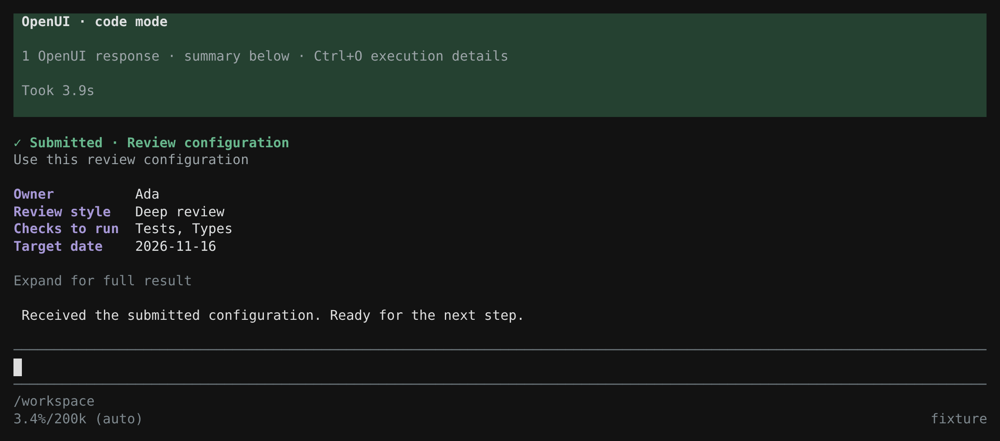
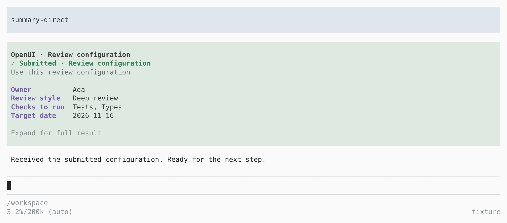

# Themed submission receipts

After a form closes, the extension displays a readable receipt while returning the complete typed result to the agent. Optional `summary` hints choose the title and important fields:

```js
const result = await tools.show_ui({
  source,
  summary: { title: "Review configuration", fields: ["owner", "priority", "checks", "date"] }
});
text(result);
```

The receipt uses the form's labels and rich option labels, not internal variable names. Field selection only changes the display. Numbers, booleans, arrays, hidden fields and internal state remain in the machine result. Cancellation and errors have their own receipt status. “Submitted” means input was received; it does not assert that any requested work has been executed.

## Native code mode

The receipt appears as a separate transcript entry below the execution block. A completed OpenUI-only script has a compact execution display; expand details to see its original code and output. The receipt itself also expands to show the full structured result. Mixed scripts retain their other calls and output.



The entry is saved in the Pi session and restored when the session is reopened. It is display metadata, so it does not create a duplicate message in the model's context. Code still needs to output the result or the fields needed by the model, as in the example above.

## Direct tool calls

Direct `show_ui` calls display their receipt in the tool result. The same rendering works with Pi's light theme:



`/openui-demo`, `--actions` and `--catalog` also display themed receipts. A demo submission sends one structured session message; cancelling a demo records a receipt without starting an agent turn.

## Model guidance

The bundled [openui skill](../skills/openui/SKILL.md) teaches component selection, form layout, typed values, actions, cancellation and receipt field selection. The extension independently injects the lang-core schemas and core rules into the active tool prompt. Install the package to discover both resources, or use `--skill ./skills/openui/SKILL.md` when loading the extension directly with `-e`. Pi needs `read` or `bash` available to include skills in its model prompt.

## Verification

All four actual Pi 1.4.0 fullscreen runs passed: dark and light themes, each with direct tools and native code-only mode. Checks covered readable field/option labels, full typed provider results, expansion, narrow resizing, cancellation, malformed input, demo delivery, skill discovery, mixed script output, and reopening a session with its receipt intact. Native code-only mode exposed only `codemode` to the provider while retaining nested `show_ui` and `read` access.

The captures replay unmodified PTY output. A deterministic local provider verified the received data; no external model provider was used. Browser tooling was used only by the external screenshot harness and is not a dependency of the extension.
