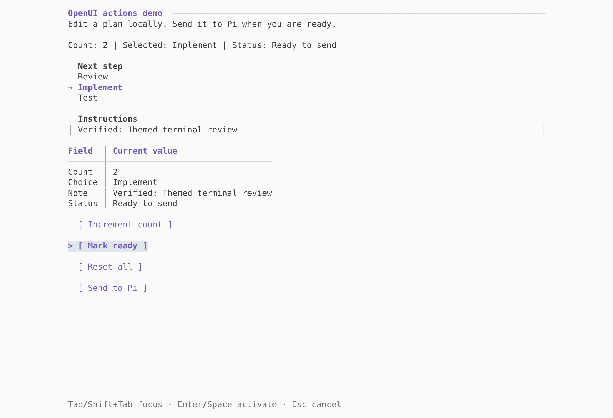
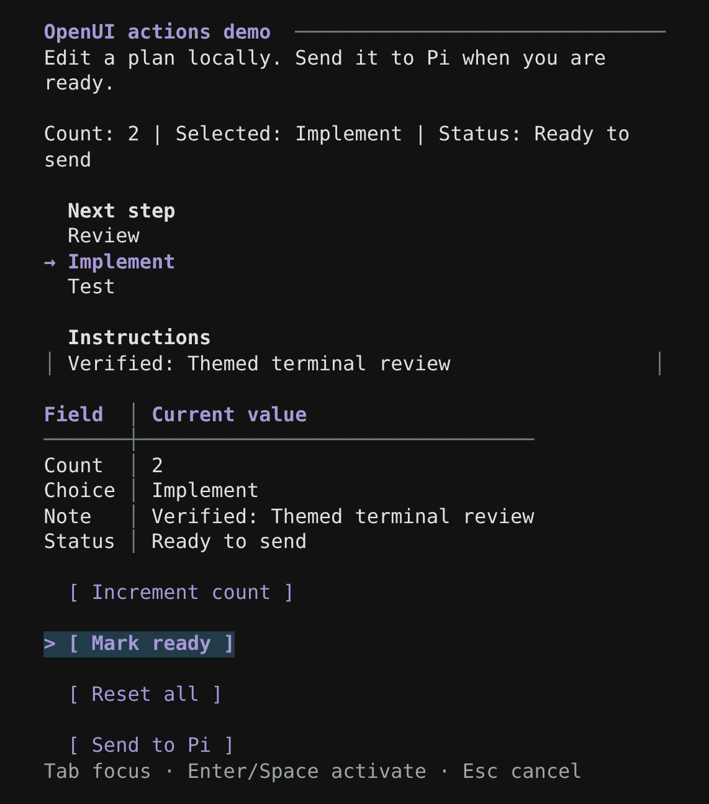
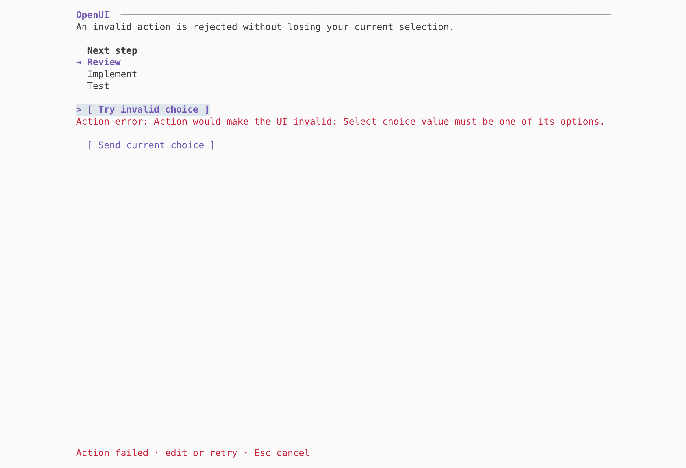

# Pi theme gallery

The same OpenUI document uses Pi's native theme tokens in both dark and light themes. These are captures of the actual Pi 1.4 CLI, with a deterministic local provider. They were made by replaying unchanged PTY output into a terminal emulator; screenshot tooling is separate from the extension.

## Dark

The action demo after mouse and keyboard edits. Field labels and table headers establish hierarchy; the selected option stays visible and the focused button has a compact highlight. The input cursor appears only when that input has focus.

## Light

The same document and interaction in Pi's light theme. Colors come from the host theme rather than a palette hardcoded by this adapter.

## Narrow terminals

Content wraps as the viewport shrinks, with compact keyboard hints that retain cancellation. At still narrower widths, tables switch to labeled records. Mouse targets track the inset and scrolling.

## Recoverable errors

An invalid local action displays its error while retaining the original values and an editable form. The user can correct the input, retry, or cancel.

Keyboard and mouse edits, local actions, reset, resizing, submission and native code-only mode were exercised in both themes. Automated tests also cover live theme changes, Unicode cursor positioning, cancellation of a click interrupted by resizing, and sanitization before styling.
